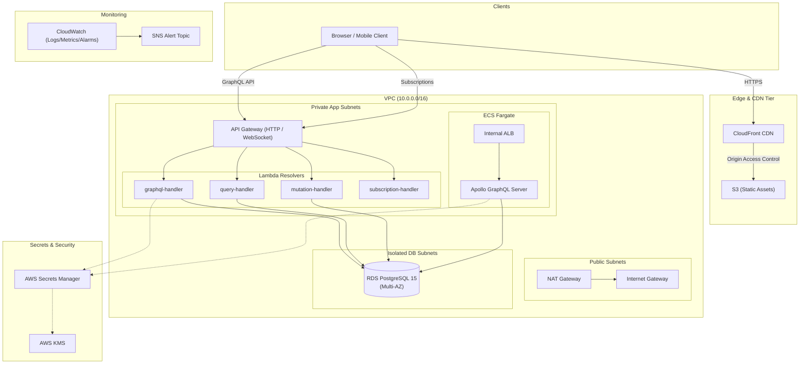

# Serverless GraphQL Architecture on AWS with RDS PostgreSQL

A full-stack, cloud-native GraphQL platform built on AWS. This project demonstrates a production-grade infrastructure combining a React frontend, serverless Lambda handlers, a containerized ECS Fargate service, and an RDS PostgreSQL database in isolated private subnets.

---

## Architecture Overview



---

## Key Design & Engineering Decisions

1. **Frontend Hosting (S3 + CloudFront OAC)**
   - Instead of legacy S3 website endpoints or deprecated Origin Access Identity (OAI), we use **CloudFront Origin Access Control (OAC)** with AWS SigV4 request signing. S3 public access is completely blocked (`BlockPublicAcls`, `BlockPublicPolicy`).
   - Caching strategy: Hashed bundle assets in `/assets/` have `max-age=31536000, immutable`. `index.html` uses `max-age=0, must-revalidate` so updates reflect immediately without cache invalidation delays.

2. **Serverless Lambda Functions (Node 20 / ARM64)**
   - Functions run on **AWS Graviton (ARM64)** for ~20% lower cost and better price-performance.
   - Handlers are separated by concern (`queries`, `mutations`, `subscriptions`, and a unified `graphql` router). This lets us set different timeout/memory profiles for read queries vs write mutations.
   - Both **Serverless Framework** (`serverless.yml`) and **AWS SAM** (`template.yaml`) templates are provided.

3. **Private ECS Fargate Service**
   - The private GraphQL server runs as a Docker container on ECS Fargate inside private application subnets behind an internal Application Load Balancer.
   - Built on a multi-stage `node:20-alpine` base image running as a non-privileged `appuser` (UID 1001) for container security.
   - ECS Deployment Circuit Breaker is enabled (`rollback = true`) to prevent broken container images from replacing healthy tasks.

4. **RDS PostgreSQL & Connection Pooling**
   - The database lives in dedicated database subnets with no route to the Internet Gateway or NAT Gateway. Ingress on port 5432 is restricted strictly to the Lambda and ECS security group IDs.
   - Because serverless functions can exhaust database connections during traffic spikes, we implement a singleton connection pool (`pg.Pool` with `max: 5` per Lambda) and cache credentials in memory across warm invocations.
   - Storage autoscaling (`20 GB` to `100 GB`) is configured to avoid disk-full outages.

5. **CI/CD with Keyless OIDC (GitHub Actions)**
   - No permanent `AWS_ACCESS_KEY_ID` or `AWS_SECRET_ACCESS_KEY` are stored in GitHub secrets. We use **GitHub Actions OpenID Connect (OIDC)** to assume a least-privilege IAM role on demand with 1-hour session tokens.

---

## Project Structure

```
├── .github/workflows/          # CI/CD Workflows
│   ├── ci.yml                  # PR quality gate (lint, build, test)
│   ├── deploy-frontend.yml     # S3 sync + CloudFront cache invalidation
│   ├── deploy-backend-lambda.yml # Serverless/SAM deploy with canary rollback
│   ├── deploy-ecs.yml          # Docker build, Trivy scan, ECR push, ECS deploy
│   └── terraform.yml           # Terraform fmt, validate, plan, apply
├── backend/
│   ├── graphql-server/         # Private Apollo Server on ECS Fargate
│   │   ├── Dockerfile          # Multi-stage Alpine container
│   │   ├── src/                # Express + Apollo Server + health check
│   │   └── task-def.json       # ECS task definition
│   └── lambda/                 # Serverless Lambda handlers
│       ├── serverless.yml      # Serverless Framework config
│       ├── template.yaml       # AWS SAM config
│       ├── src/handlers/       # graphql, queries, mutations, subscriptions
│       └── src/db/             # pg.Pool client, schema migrations
├── frontend/                   # React 18 + Vite + Tailwind SPA
│   ├── src/                    # Apollo Client, components, GraphQL queries
│   └── index.html
├── infrastructure/terraform/   # Terraform modules
│   ├── modules/vpc/            # Multi-AZ VPC, subnets, NAT, security groups
│   ├── modules/rds/            # RDS PostgreSQL 15 Multi-AZ
│   ├── modules/ecs/            # Cluster, task definition, ALB, autoscaling
│   ├── modules/frontend_s3_cloudfront/ # S3 bucket + CloudFront + OAC
│   ├── modules/iam/            # Least-privilege roles + GitHub OIDC
│   ├── modules/secrets/        # Secrets Manager + KMS key
│   └── modules/cloudwatch/     # Alarms, metrics, SNS topic, dashboard
└── docs/                       # Engineering runbooks and deep dives
    ├── ARCHITECTURE.md
    ├── DEPLOYMENT_GUIDE.md
    ├── IAM_SECURITY.md
    ├── CICD_PIPELINE.md
    ├── DATABASE_BEST_PRACTICES.md
    └── MONITORING_AND_ROLLBACK.md
```

---

## Running Locally

You don't need an active AWS account to test and run the project locally.

### Option A: Quick Demo Server (Zero Setup)
We have a local server that emulates the backend endpoints, database, and health check:

```bash
node local-demo-server.js
```

Open:
- **Dashboard UI**: [http://localhost:4000/app](http://localhost:4000/app)
- **Interactive GraphQL Explorer**: [http://localhost:4000/graphql](http://localhost:4000/graphql)
- **Health Check**: [http://localhost:4000/health](http://localhost:4000/health)

### Option B: Docker Compose (Full Stack)
If you have Docker Desktop installed:
```bash
docker compose up
```
This spins up:
1. `postgres`: Real PostgreSQL 15 container initialized with schema tables.
2. `graphql-server`: The compiled Apollo Server container.
3. `frontend`: The React Vite dev server on port 3000.

---

## Deploying to AWS

For production deployment steps, prerequisite checklists, and verification tests, read the [Deployment Runbook](docs/DEPLOYMENT_GUIDE.md).

```bash
# 1. Provision Infrastructure
cd infrastructure/terraform
cp terraform.tfvars.example terraform.tfvars
terraform init
terraform apply

# 2. Deploy Lambda Functions
cd ../../backend/lambda
npm install && npm run build
npx serverless deploy --stage prod

# 3. Build & Deploy ECS Container
cd ../graphql-server
docker build -t graphql-server .
docker push <ECR_URL>:latest
aws ecs update-service --cluster prod-graphql-cluster --service prod-graphql-service --force-new-deployment

# 4. Deploy Frontend
cd ../../frontend
npm install && npm run build
aws s3 sync dist/ s3://<BUCKET_NAME>/ --delete
aws cloudfront create-invalidation --distribution-id <DIST_ID> --paths "/*"
```

---

## Detailed Documentation
- [System Architecture & Network Flow](docs/ARCHITECTURE.md)
- [Deployment & Local Testing Runbook](docs/DEPLOYMENT_GUIDE.md)
- [IAM Least-Privilege & GitHub OIDC](docs/IAM_SECURITY.md)
- [CI/CD Workflows & Rollback Matrix](docs/CICD_PIPELINE.md)
- [PostgreSQL Connection Pooling & High Availability](docs/DATABASE_BEST_PRACTICES.md)
- [CloudWatch Metrics, Alarms & Auto-Scaling](docs/MONITORING_AND_ROLLBACK.md)
