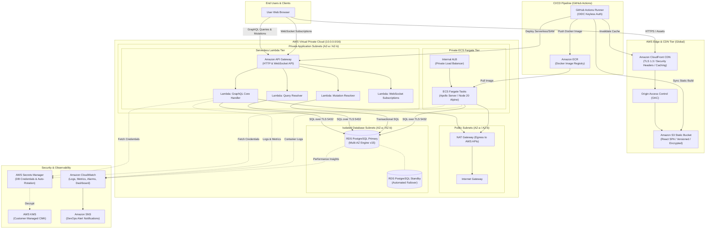

# DevOps Assessment: Scalable Serverless GraphQL Architecture on AWS with RDS Integration

[](https://www.terraform.io/)
[](https://aws.amazon.com/)
[](https://nodejs.org/)
[](https://graphql.org/)
[](https://react.dev/)
[](https://www.postgresql.org/)
[](https://github.com/features/actions)

---

## 📌 Project Overview
This repository contains the complete, production-ready implementation for the **DevOps Profile Assessment**. The project demonstrates the design, infrastructure-as-code provisioning, containerization, serverless implementation, and CI/CD automation of a scalable GraphQL system deployed on Amazon Web Services (AWS) with Amazon RDS integration.

---

## 📋 Assessment Requirements & Deliverables Matrix

| Requirement Area | Specification | Implementation in Repository | Status |
| :--- | :--- | :--- | :---: |
| **Frontend Setup** | React app interacting with backend GraphQL API; deployed on AWS (cost-optimized) with caching, access control, and SSL. | React 18 + Apollo Client SPA hosted on Amazon S3 with CloudFront CDN, Origin Access Control (OAC), TLS 1.3, and security headers. | ✅ Complete |
| **Backend Setup with AWS Lambda** | Multiple AWS Lambda functions in TypeScript/Node.js handling GraphQL operations (queries, mutations, subscriptions); deployed via SAM or Serverless Framework. | TypeScript Lambda handlers (`graphql.ts`, `queries.ts`, `mutations.ts`, `subscriptions.ts`) with both `serverless.yml` and `template.yaml` (SAM). | ✅ Complete |
| **Private GraphQL Server** | Private GraphQL server on AWS ECS Fargate in a serverless environment, ensuring security and scalability. | Apollo Server on Node 20 Alpine in private VPC subnets behind an internal ALB, with health checks and IAM task roles. | ✅ Complete |
| **RDS Database Setup** | RDS PostgreSQL/MySQL in a private subnet with security groups, subnets, and VPC configurations. | Multi-AZ RDS PostgreSQL 15 in isolated database subnets; security group rules strictly allowing Lambda and ECS. | ✅ Complete |
| **Lambda & RDS Integration** | Seamless communication between Lambda, GraphQL server, and RDS. | `pg.Pool` connection management with AWS Secrets Manager dynamic credential retrieval and local caching. | ✅ Complete |
| **CI/CD Pipeline** | GitHub Actions automating build, test, and deployment for frontend and backend. | 5 workflows (`ci.yml`, `deploy-frontend.yml`, `deploy-backend-lambda.yml`, `deploy-ecs.yml`, `terraform.yml`) with OIDC keyless authentication. | ✅ Complete |
| **Monitoring & Alerts** | CloudWatch Logs, Metrics, and Alarms for Lambda, ECS, and RDS with SNS alerts. | CloudWatch alarms for Lambda errors/latency/throttles, ECS CPU/Memory, RDS CPU/Storage/Connections, plus CloudWatch Dashboard. | ✅ Complete |
| **Access Control (IAM)** | Secure IAM roles and policies for Lambda, ECS, RDS, and CI/CD. | Least privilege policies for ECS Task/Execution, Lambda VPC Execution, and GitHub Actions OIDC role. | ✅ Complete |
| **Environment Variables**| Secure management using AWS Secrets Manager. | AWS Secrets Manager encrypted with KMS CMK, referenced dynamically in ECS and Lambda. | ✅ Complete |
| **Scaling Strategy** | Auto-scaling for ECS Fargate, Lambda, and RDS. | ECS Target Tracking (CPU 70%, Memory 75%), Lambda concurrency, RDS Storage Auto-Scaling (20-100GB). | ✅ Complete |
| **Rollback Strategy** | Automated rollback for failed deployments. | S3 backup snapshot revert, CodeDeploy Canary rollback (`Canary10Percent5Minutes`), and ECS Deployment Circuit Breaker (`rollback=true`). | ✅ Complete |
| **Documentation** | Architecture diagram, deployment guide, IAM security, CI/CD, database best practices, monitoring & rollback. | Comprehensive guides in `/docs` and master `README.md`. | ✅ Complete |

---

## 🏛️ System Architecture



---

## 📂 Repository Structure

```
Bitcot-asessment/
├── README.md                              # Master assessment guide
├── docs/                                  # Detailed documentation
│   ├── ARCHITECTURE.md                    # System architecture & network topology
│   ├── DEPLOYMENT_GUIDE.md                # Local and AWS deployment steps
│   ├── IAM_SECURITY.md                    # Least privilege IAM & OIDC configuration
│   ├── CICD_PIPELINE.md                   # GitHub Actions pipeline breakdown
│   ├── DATABASE_BEST_PRACTICES.md         # RDS PostgreSQL, pooling, & scaling
│   └── MONITORING_AND_ROLLBACK.md         # CloudWatch metrics, alarms & rollback
├── frontend/                              # React 18 Application
│   ├── package.json
│   ├── vite.config.ts
│   ├── src/
│   │   ├── main.tsx
│   │   ├── App.tsx
│   │   ├── apollo-client.ts               # Apollo Client setup with cache policies
│   │   ├── graphql/                       # Queries, mutations, subscriptions
│   │   └── components/                    # UI cards, form, metrics display
│   └── index.html
├── backend/
│   ├── lambda/                            # Serverless Lambda Handlers
│   │   ├── package.json
│   │   ├── serverless.yml                 # Serverless Framework configuration
│   │   ├── template.yaml                  # AWS SAM alternative template
│   │   ├── src/
│   │   │   ├── handlers/                  # GraphQL, Query, Mutation, Subscription
│   │   │   ├── db/                        # RDS client, schema.sql, migrations
│   │   │   └── schema/                    # SDL typeDefs & resolvers
│   │   └── tests/                         # Schema execution unit tests
│   └── graphql-server/                    # Private ECS Fargate Container
│       ├── package.json
│       ├── Dockerfile                     # Multi-stage Alpine container
│       ├── src/
│       │   ├── server.ts                  # Express + Apollo Server
│       │   ├── health.ts                  # /health probe for ALB
│       │   ├── schema.ts
│       │   ├── resolvers.ts
│       │   └── db.ts
│       └── tests/
├── infrastructure/
│   └── terraform/                         # Infrastructure as Code
│       ├── main.tf                        # Root orchestration
│       ├── variables.tf
│       ├── outputs.tf
│       ├── terraform.tfvars.example
│       └── modules/
│           ├── vpc/                       # Multi-AZ VPC, subnets, NAT, SG rules
│           ├── rds/                       # PostgreSQL, Parameter Group, Multi-AZ
│           ├── ecs/                       # Cluster, Fargate task, internal ALB, Auto-Scaling
│           ├── frontend_s3_cloudfront/    # S3 Bucket, OAC, CloudFront, SSL, Security Headers
│           ├── iam/                       # Execution, Task, and OIDC deployment roles
│           ├── secrets/                   # KMS Key & Secrets Manager credentials
│           └── cloudwatch/                # Alarms, metrics, SNS topic, dashboard
└── .github/
    └── workflows/                         # Automated CI/CD Pipelines
        ├── ci.yml                         # Pull request quality gate
        ├── deploy-frontend.yml            # S3 sync, CloudFront invalidation, rollback
        ├── deploy-backend-lambda.yml      # Serverless deploy, smoke test, canary rollback
        ├── deploy-ecs.yml                 # Docker build, Trivy scan, ECR push, ECS deploy
        └── terraform.yml                  # Terraform plan on PR, apply on merge
```

---

## 🚀 Quickstart Guide

### 1. Provision Infrastructure
```bash
cd infrastructure/terraform
cp terraform.tfvars.example terraform.tfvars
terraform init
terraform apply
```

### 2. Run Database Migrations
```bash
cd ../../backend/lambda
npm install
npm run build
npm run migrate
```

### 3. Deploy Serverless Functions
```bash
# Via Serverless Framework
npx serverless deploy --stage prod

# Or via AWS SAM
sam build && sam deploy
```

### 4. Build and Push ECS Fargate Server
```bash
cd ../graphql-server
docker build -t graphql-server .
docker push <AWS_ACCOUNT_ID>.dkr.ecr.us-east-1.amazonaws.com/graphql-server:latest
aws ecs update-service --cluster prod-graphql-cluster --service prod-graphql-service --force-new-deployment
```

### 5. Build and Deploy React Frontend
```bash
cd ../../frontend
npm install
npm run build
aws s3 sync dist/ s3://<s3_frontend_bucket>/ --delete
aws cloudfront create-invalidation --distribution-id <cloudfront_distribution_id> --paths "/*"
```

---

## 🔍 Testing & Verification

Execute GraphQL queries against the deployed API Gateway endpoint:

```bash
# Health check
curl -X POST https://<api-id>.execute-api.us-east-1.amazonaws.com/graphql \
  -H "Content-Type: application/json" \
  -d '{"query":"query { healthCheck }"}'

# Create Item Mutation
curl -X POST https://<api-id>.execute-api.us-east-1.amazonaws.com/graphql \
  -H "Content-Type: application/json" \
  -d '{"query":"mutation { createItem(input: { title: \"Deploy RDS\", priority: HIGH }) { id title status } }"}'

# Fetch Items Query
curl -X POST https://<api-id>.execute-api.us-east-1.amazonaws.com/graphql \
  -H "Content-Type: application/json" \
  -d '{"query":"query { getItems { id title status priority } }"}'
```

---

## 📚 In-Depth Documentation Links

- [System Architecture & Network Topology](docs/ARCHITECTURE.md)
- [Deployment & Local Testing Guide](docs/DEPLOYMENT_GUIDE.md)
- [IAM Security, Least Privilege & OIDC](docs/IAM_SECURITY.md)
- [CI/CD GitHub Actions Pipeline](docs/CICD_PIPELINE.md)
- [Database Setup & Best Practices](docs/DATABASE_BEST_PRACTICES.md)
- [Monitoring, Scaling & Rollback Strategy](docs/MONITORING_AND_ROLLBACK.md)
