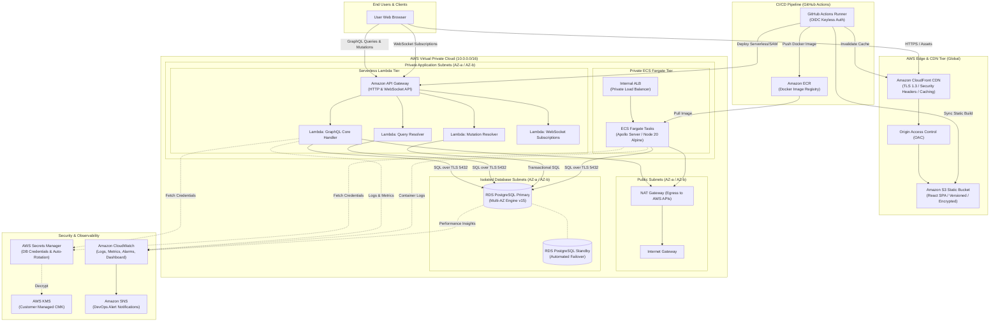

# System Architecture Overview

## Executive Summary
This document details the architectural design and implementation of a scalable, highly secure, serverless GraphQL architecture deployed on Amazon Web Services (AWS). The system integrates a modern React frontend with a hybrid backend comprising AWS Lambda serverless functions and a containerized private GraphQL server on AWS ECS Fargate, backed by an isolated AWS RDS PostgreSQL database.

---

## 1. High-Level Architecture Diagram



---

## 2. Component Breakdown & Responsibilities

| Tier / Component | Technology | Role & Key Features |
| :--- | :--- | :--- |
| **Frontend CDN** | Amazon CloudFront | Delivers React SPA with sub-second latency globally. Configured with TLS 1.3, strict security headers (HSTS, CSP, X-Frame-Options: DENY), and cost-optimized PriceClass_100. |
| **Static Storage** | Amazon S3 | Private static asset hosting via **Origin Access Control (OAC)**. S3 Bucket versioning enabled for instantaneous rollback. |
| **Serverless API** | AWS API Gateway | Provides HTTP API for low-latency GraphQL queries and REST endpoints, and WebSocket API for real-time GraphQL subscriptions. |
| **Serverless Compute** | AWS Lambda (Node.js 20 ARM64) | Micro-functions executing in VPC private subnets. Split by operation (Core GraphQL, Queries, Mutations, Subscriptions) for independent scaling and isolation. |
| **Container Compute** | AWS ECS Fargate | Private, containerized Apollo Server deployed across multiple AZs behind an internal ALB. Configured with Deployment Circuit Breaker for automatic rollback. |
| **Relational Database**| AWS RDS PostgreSQL 15 | Multi-AZ deployment in isolated database subnets. Configured with storage auto-scaling (20GB to 100GB), SSL enforcement, and automated backups. |
| **Secrets Management**| AWS Secrets Manager & KMS | Stores and generates database credentials with customer-managed encryption (KMS CMK). Local caching in Lambda prevents API throttling. |
| **Observability** | Amazon CloudWatch & SNS | Real-time monitoring of invocations, errors, latency, CPU, and DB connections, triggering alerts to an SNS topic. |
| **CI/CD Automation** | GitHub Actions (OIDC) | Keyless, automated pipeline for building, testing, security scanning (Trivy), and deploying with rollback mechanisms. |

---

## 3. Network Topology & Traffic Segregation

The network architecture adheres to the standard AWS Multi-Tier VPC pattern across 2 Availability Zones (`us-east-1a` and `us-east-1b`):

```
VPC CIDR: 10.0.0.0/16
├── Public Subnets (10.0.1.0/24, 10.0.2.0/24)
│   ├── Internet Gateway (IGW)
│   └── NAT Gateway (Elastic IP allocated)
│
├── Private Application Subnets (10.0.10.0/24, 10.0.20.0/24)
│   ├── Route: 0.0.0.0/0 -> NAT Gateway
│   ├── AWS Lambda Elastic Network Interfaces (ENIs)
│   ├── AWS ECS Fargate Tasks
│   └── Internal Application Load Balancer
│
└── Private Isolated Database Subnets (10.0.30.0/24, 10.0.40.0/24)
    ├── Route: Local VPC only (No Internet Gateway / No NAT route)
    ├── RDS PostgreSQL Primary Instance
    └── RDS PostgreSQL Multi-AZ Standby Instance
```

### Security Group Ingress / Egress Matrix

| Security Group | Inbound Rules | Outbound Rules | Purpose |
| :--- | :--- | :--- | :--- |
| **ALB SG** | Port 80/443 from VPC CIDR (`10.0.0.0/16`) | All traffic (`0.0.0.0/0`) | Internal ALB routing |
| **ECS Tasks SG** | Port 4000 from **ALB SG** only | All traffic (`0.0.0.0/0`) via NAT | Apollo Server container |
| **Lambda SG** | None (invocation via AWS internal control plane) | All traffic (`0.0.0.0/0`) via NAT | Lambda execution in VPC |
| **RDS SG** | Port 5432 strictly from **ECS Tasks SG** and **Lambda SG** | None | PostgreSQL database isolation |

---

## 4. End-to-End Request Flows

### A. GraphQL Query / Mutation Flow
1. User interacts with React app hosted on CloudFront CDN.
2. Apollo Client sends GraphQL POST request to Amazon API Gateway.
3. API Gateway routes request to `GraphQLFunction` Lambda running in Private App Subnet.
4. Lambda retrieves DB credentials from local memory cache (or Secrets Manager on cold start).
5. Lambda acquires connection from PostgreSQL connection pool (`pg.Pool`).
6. Query/mutation executes against RDS PostgreSQL in Isolated DB Subnet over encrypted TLS.
7. Result returns through API Gateway to Apollo Client in browser.

### B. Real-Time Subscription Flow
1. React client establishes persistent WSS connection to API Gateway WebSocket endpoint.
2. `$connect` route invokes `SubscriptionFunction` Lambda, storing `connectionId` in RDS table `websocket_connections`.
3. When a mutation occurs, the server publishes an event to subscribed connections.
4. `SubscriptionFunction` broadcasts payload using `@aws-sdk/client-apigatewaymanagementapi`.
5. Upon client disconnect, `$disconnect` cleans up the record from the database.
