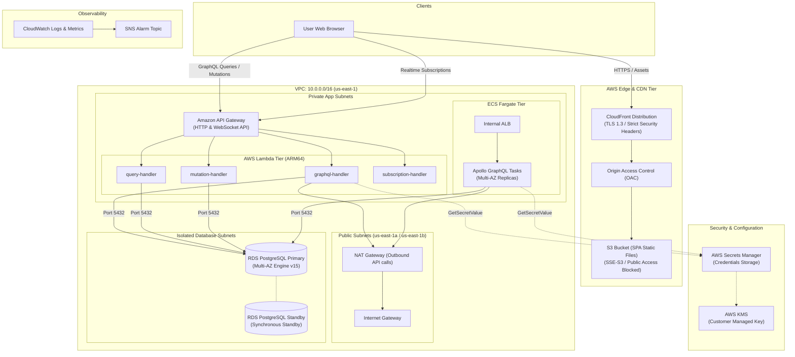

# Architecture Specification & Network Topology

This document outlines the architecture, network design, and security boundaries for the serverless GraphQL infrastructure.

---

## 1. High-Level Diagram

---

## 2. Infrastructure Components

### Edge Tier
- **CloudFront Distribution**: Serves as the single global ingress for the React SPA. We configure standard HTTP security headers (HSTS, CSP, X-Frame-Options: DENY, X-Content-Type-Options: nosniff).
- **Amazon S3**: Hosts static compiled assets (`dist/`). All public bucket policies are turned off; requests are authenticated strictly through CloudFront OAC.

### Application Tier
- **Amazon API Gateway**:
  - HTTP API handles POST `/graphql` and dedicated REST endpoints (`/api/items`, `/api/mutate`).
  - WebSocket API routes `$connect`, `$disconnect`, `subscribe`, and event broadcasts for real-time GraphQL subscriptions.
- **AWS Lambda**:
  - Built with TypeScript and Node.js 20 on ARM64 Graviton instances.
  - Split into distinct handlers for reads vs transactional writes to allow independent scaling, memory allocation, and timeout tuning.
  - Sits in private application subnets (`10.0.10.0/24`, `10.0.20.0/24`) with attached VPC ENIs.
- **AWS ECS Fargate**:
  - Containerized Apollo Server deployment behind an internal Application Load Balancer.
  - Scales automatically using AWS Application Auto-Scaling based on average CPU (70%) and Memory (75%) utilization.
  - Minimum 2 tasks across two availability zones for high availability.

### Data Tier
- **AWS RDS PostgreSQL (v15)**:
  - Deployed in isolated database subnets (`10.0.30.0/24`, `10.0.40.0/24`) with `publicly_accessible = false`.
  - Multi-AZ synchronous replication provides automated failover under 60 seconds without data loss.
  - Storage autoscaling is enabled from 20 GB to 100 GB.

---

## 3. Network Segmentation & Security Group Rules

| Security Group | Ingress Source | Allowed Ports | Purpose |
| :--- | :--- | :--- | :--- |
| **`alb-sg`** | VPC CIDR (`10.0.0.0/16`) | `80`, `443` | Internal ALB routing |
| **`ecs-tasks-sg`** | `alb-sg` | `4000` | Traffic from ALB to Apollo Server container |
| **`lambda-sg`** | None | Outbound only | Lambda VPC network interfaces |
| **`rds-sg`** | `ecs-tasks-sg`, `lambda-sg` | `5432` | PostgreSQL access strictly from app compute |

---

## 4. Operational Flows

### Read / Query Path
1. The browser requests items through Apollo Client.
2. API Gateway passes the request to `queryHandler` Lambda (or `graphqlHandler`).
3. The Lambda checks for a warm PostgreSQL connection pool (`pg.Pool`).
4. If cold, it fetches database credentials from AWS Secrets Manager and caches them in memory.
5. The query executes against RDS PostgreSQL; results are returned with cache-friendly response headers.

### Transactional Mutation Path
1. The client issues a mutation (e.g. `createItem`).
2. API Gateway invokes `mutationHandler` Lambda.
3. The function begins a database transaction (`BEGIN`), performs the insert/update, logs an entry to the `audit_logs` table, and commits (`COMMIT`).
4. On success, an event payload is forwarded to the WebSocket subscription broadcaster.
