# CI/CD Pipeline with GitHub Actions

## 1. Pipeline Architecture

The continuous integration and deployment strategy uses modular GitHub Actions workflows to guarantee code quality, automated testing, container security scanning, and zero-downtime deployments with automated rollback.

```mermaid
flowchart TD
    subgraph Triggers["Pipeline Triggers"]
        PR["Pull Request to main"]
        Merge["Push / Merge to main"]
        Manual["workflow_dispatch (Manual Run)"]
    end

    subgraph CI["Quality Gate Workflow (ci.yml)"]
        L_Frontend["Frontend TypeCheck & Build"]
        L_Lambda["Lambda Compile & Unit Tests"]
        L_ECS["ECS Docker Build Test"]
        L_TF["Terraform fmt & validate"]
    end

    subgraph CD_Frontend["Frontend Deployment (deploy-frontend.yml)"]
        F_Build["Build React SPA"]
        F_Backup["Backup Previous S3 Release"]
        F_Sync["Sync dist/ to S3 with OAC"]
        F_Invalidate["Invalidate CloudFront Cache"]
        F_Smoke["Smoke Test (HTTP 200)"]
        F_Rollback{"Pass Smoke Test?"}
        F_Revert["Automated Revert to S3 Backup"]

        F_Build --> F_Backup --> F_Sync --> F_Invalidate --> F_Smoke --> F_Rollback
        F_Rollback -- No --> F_Revert
    end

    subgraph CD_Lambda["Lambda Deployment (deploy-backend-lambda.yml)"]
        L_Build["Compile TypeScript"]
        L_Deploy["Deploy via Serverless/SAM"]
        L_Canary["Canary Traffic Shift (10% / 5m)"]
        L_Verify["Verify GraphQL Health Check"]
        L_Alarm{"CloudWatch Alarms Clean?"}
        L_AutoRollback["Automated CodeDeploy Rollback"]

        L_Build --> L_Deploy --> L_Canary --> L_Verify --> L_Alarm
        L_Alarm -- Alarm Fired --> L_AutoRollback
    end

    subgraph CD_ECS["ECS Fargate Deployment (deploy-ecs.yml)"]
        E_Docker["Build Multi-Stage Image"]
        E_Trivy["Security Scan (Trivy CVEs)"]
        E_Push["Push Image to Amazon ECR"]
        E_Update["Update ECS Task Definition"]
        E_Wait["Wait for Service Stability"]
        E_Circuit{"Circuit Breaker OK?"}
        E_Rollback["Auto Rollback to Previous Task"]

        E_Docker --> E_Trivy --> E_Push --> E_Update --> E_Wait --> E_Circuit
        E_Circuit -- Failure Detected --> E_Rollback
    end

    PR --> CI
    Merge --> CD_Frontend
    Merge --> CD_Lambda
    Merge --> CD_ECS
    Manual --> CD_Frontend
    Manual --> CD_Lambda
    Manual --> CD_ECS
```

---

## 2. GitHub Secrets & Variables Configuration

To run the workflows, configure the following secrets in your GitHub repository (`Settings > Secrets and variables > Actions`):

| Secret Name | Type | Description |
| :--- | :--- | :--- |
| `AWS_DEPLOY_ROLE_ARN` | Secret | ARN of the IAM OIDC deployment role (`arn:aws:iam::<account>:role/prod-github-actions-deploy-role`). |
| `AWS_REGION` | Secret / Var | Deployment region (e.g., `us-east-1`). |
| `S3_FRONTEND_BUCKET` | Secret | Target S3 bucket name for React static assets. |
| `CLOUDFRONT_DISTRIBUTION_ID`| Secret | CloudFront distribution ID for cache invalidation. |
| `CLOUDFRONT_DOMAIN_NAME` | Secret | Domain name of the CloudFront distribution for smoke testing. |
| `GRAPHQL_API_URL` | Secret | API Gateway URL for GraphQL queries & mutations. |
| `DB_SECRET_ARN` | Secret | Secrets Manager ARN for database credentials. |
| `DB_HOST` | Secret | RDS PostgreSQL endpoint address. |
| `LAMBDA_SG_ID` | Secret | Security group ID for Lambda functions. |
| `PRIVATE_SUBNET_1` | Secret | Private application subnet 1 ID. |
| `PRIVATE_SUBNET_2` | Secret | Private application subnet 2 ID. |
| `ECR_REPOSITORY` | Secret / Var | Amazon ECR repository name (`graphql-server`). |
| `ECS_CLUSTER_NAME` | Secret / Var | ECS cluster name (`prod-graphql-cluster`). |
| `ECS_SERVICE_NAME` | Secret / Var | ECS service name (`prod-graphql-service`). |

---

## 3. Workflow Breakdown

### A. CI Quality Gate (`ci.yml`)
- Runs automatically on all Pull Requests targeting `main`.
- Matrix checks:
  1. Frontend: Type checking (`tsc`) and production build.
  2. Lambda: Compilation and schema execution unit tests.
  3. ECS Fargate: Dockerfile multi-stage build check.
  4. Terraform: HCL format validation and module validation.

### B. Frontend Deployment (`deploy-frontend.yml`)
- **Key Features**:
  - Implements split-cache deployment:
    - JavaScript and CSS files in `/assets/` have content hashes and are deployed with `Cache-Control: public, max-age=31536000, immutable`.
    - `index.html` is deployed with `Cache-Control: public, max-age=0, must-revalidate` to ensure immediate updates upon deployment.
  - Takes a timestamped snapshot of the current S3 files before syncing.
  - Runs cURL smoke test against CloudFront.
  - Reverts to the snapshot if any step fails.

### C. Lambda Deployment (`deploy-backend-lambda.yml`)
- **Key Features**:
  - Compiles TypeScript into optimized ESM bundles.
  - Deploys using Serverless Framework with AWS CodeDeploy integration.
  - Traffic is shifted gradually via `Canary10Percent5Minutes`.
  - Executes a post-deployment GraphQL query test.
  - If errors spike during the canary window, AWS CodeDeploy triggers an automated rollback to the previous Lambda version alias.

### D. ECS Fargate Deployment (`deploy-ecs.yml`)
- **Key Features**:
  - Multi-stage Docker build minimizing container size.
  - Trivy container security scanner audits the image for CVE vulnerabilities before pushing.
  - Pushes images with immutable Git commit SHA tags and updates `latest`.
  - Renders task definition and deploys with `--wait-for-service-stability`.
  - Leverages AWS ECS **Deployment Circuit Breaker** with `rollback = true`. If tasks crash or fail the `/health` check, ECS automatically terminates the failing deployment and reverts to the previous task definition.
