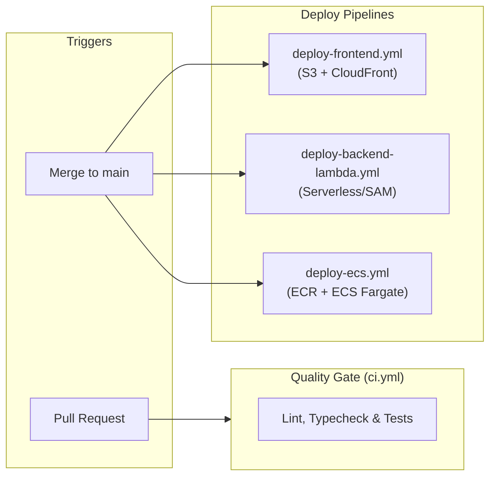

# CI/CD Workflows & Automated Rollbacks

This document describes the GitHub Actions workflows and the rollback strategies across the stack.

---

## 1. Workflow Architecture

---

## 2. Workflows Overview

### A. CI Quality Gate (`.github/workflows/ci.yml`)
Runs on all pull requests targeting `main`.
- **Frontend Job**: Runs TypeScript type checking (`tsc --noEmit`) and bundle build.
- **Lambda Job**: Compiles TypeScript handlers and executes GraphQL schema unit tests.
- **ECS Server Job**: Validates the multi-stage Docker build.
- **Terraform Job**: Runs `terraform fmt -check` and validation across all modules.

### B. Frontend Deployment (`.github/workflows/deploy-frontend.yml`)
Triggered on changes to `frontend/**`.
1. Builds production React bundle using Vite.
2. Creates a timestamped S3 backup folder of the current deployment.
3. Syncs `/assets/` with an immutable 1-year cache policy (`max-age=31536000, immutable`).
4. Syncs `index.html` with a zero-cache policy (`max-age=0, must-revalidate`).
5. Invalidates the CloudFront cache.
6. Performs a cURL smoke check.
7. **Rollback**: If the smoke check or sync fails, GitHub Actions automatically reverts the S3 objects from the timestamped backup and re-invalidates CloudFront.

### C. Lambda Deployment (`.github/workflows/deploy-backend-lambda.yml`)
Triggered on changes to `backend/lambda/**`.
1. Compiles TypeScript into `dist/`.
2. Deploys using the Serverless Framework with AWS CodeDeploy integration.
3. Uses canary routing (`Canary10Percent5Minutes`) to shift 10% of traffic first.
4. Executes a post-deploy health check against the live endpoint.
5. **Rollback**: If CloudWatch errors spike or the health query fails during the canary window, CodeDeploy cancels the shift and reverts 100% of traffic back to the prior Lambda alias.

### D. ECS Fargate Deployment (`.github/workflows/deploy-ecs.yml`)
Triggered on changes to `backend/graphql-server/**`.
1. Builds the container image tagged with both Git commit SHA and `latest`.
2. Runs vulnerability scanning via Trivy.
3. Pushes images to Amazon ECR.
4. Registers a new ECS task definition and updates the service.
5. **Rollback**: Leverages ECS **Deployment Circuit Breaker** (`rollback = true`). If tasks fail their container health check (`/health`) or exit repeatedly, ECS automatically terminates the failing deployment and reverts to the previous stable Task Definition.

---

## 3. Required GitHub Secrets

| Secret Name | Purpose | Example |
| :--- | :--- | :--- |
| `AWS_DEPLOY_ROLE_ARN` | OIDC IAM Role ARN | `arn:aws:iam::123456789012:role/prod-github-actions-deploy-role` |
| `AWS_REGION` | Deployment AWS region | `us-east-1` |
| `S3_FRONTEND_BUCKET` | Destination S3 static bucket | `prod-react-frontend-abc123` |
| `CLOUDFRONT_DISTRIBUTION_ID` | CloudFront Distribution ID | `E1A2B3C4D5E6F7` |
| `CLOUDFRONT_DOMAIN_NAME` | CloudFront Domain URL | `d123456abcdef.cloudfront.net` |
| `GRAPHQL_API_URL` | API Gateway endpoint | `https://abc123xyz.execute-api.us-east-1.amazonaws.com` |
| `DB_SECRET_ARN` | Secrets Manager secret ARN | `arn:aws:secretsmanager:us-east-1:...:secret:...` |
| `DB_HOST` | RDS PostgreSQL endpoint | `prod-postgres-db.c123456.us-east-1.rds.amazonaws.com` |
| `LAMBDA_SG_ID` | Lambda Security Group ID | `sg-0123456789abcdef` |
| `PRIVATE_SUBNET_1` | Private Subnet 1 ID | `subnet-0123456789abcdef` |
| `PRIVATE_SUBNET_2` | Private Subnet 2 ID | `subnet-0987654321fedcba` |
