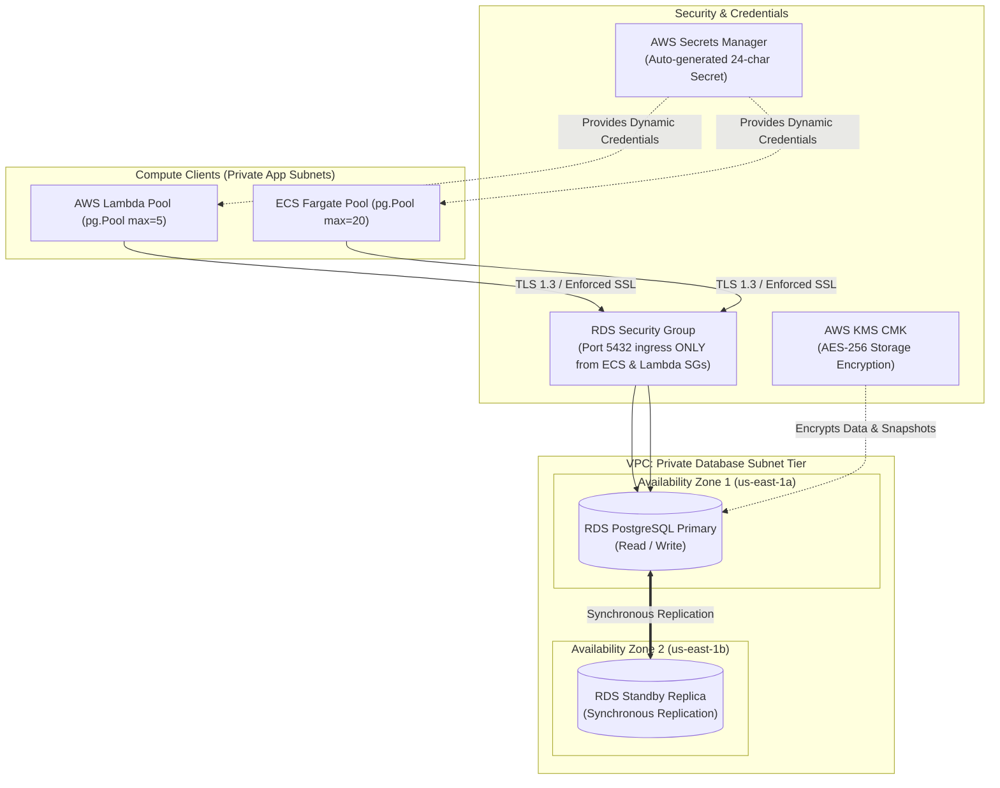

# Database Setup and Security Best Practices

## 1. AWS RDS PostgreSQL Architecture

The relational database layer is engineered for enterprise-grade security, high availability, performance, and compliance.



---

## 2. Security Configurations & Network Isolation

### A. Subnet Isolation
- The RDS instance resides strictly in **Private Isolated Database Subnets** across two Availability Zones (`10.0.30.0/24` and `10.0.40.0/24`).
- **No Internet Gateway Route**: The route table for the database subnets has zero routes to the Internet Gateway or NAT Gateway. It is strictly unroutable from external networks.
- `publicly_accessible = false` is explicitly enforced in Terraform.

### B. Security Group Ingress Rule
Database port 5432 is restricted exclusively to the specific Security Group IDs of the application tiers:
```hcl
ingress {
  description     = "PostgreSQL access from ECS Fargate tasks"
  from_port       = 5432
  to_port         = 5432
  protocol        = "tcp"
  security_groups = [var.ecs_security_group_id]
}

ingress {
  description     = "PostgreSQL access from Lambda functions"
  from_port       = 5432
  to_port         = 5432
  protocol        = "tcp"
  security_groups = [var.lambda_security_group_id]
}
```

### C. Encryption at Rest & In-Transit
- **At Rest**: Storage is encrypted with an AWS KMS Customer Managed Key (`gp3` EBS volumes).
- **In-Transit**: The custom DB Parameter Group enforces `rds.force_ssl = 1`. Any unencrypted connection attempt is rejected at the database engine level.

---

## 3. Connection Pooling Strategy for Serverless

In a serverless architecture, Lambda functions scale horizontally by spinning up concurrent execution environments. Without connection management, hundreds of concurrent Lambdas can quickly exhaust PostgreSQL's maximum connection limit (`max_connections`).

### Multi-Layer Mitigation Strategy:
1. **Container Reuse & Singleton Pool**:
   In `backend/lambda/src/db/client.ts`, the `pg.Pool` instance is declared outside the handler function to be reused across warm invocations:
   ```typescript
   export async function getDbPool(): Promise<Pool> {
     if (poolInstance) return poolInstance;
     // ...
     poolInstance = new Pool({
       max: 5, // Limit per Lambda container
       idleTimeoutMillis: 30000,
       connectionTimeoutMillis: 5000,
     });
     return poolInstance;
   }
   ```
2. **Secrets Manager Caching**:
   Credentials fetched from Secrets Manager are cached in global memory to eliminate repetitive Secrets Manager API calls on warm invocations.
3. **RDS Proxy (Recommended for High Scale)**:
   For workloads exceeding 10,000 requests/sec, AWS RDS Proxy can be layered between Lambda and RDS to pool and share database connections, maintaining sub-millisecond connection times.

---

## 4. Storage Auto-Scaling & High Availability

- **Multi-AZ Deployment**:
  Configuring `multi_az = true` creates a synchronous standby replica in a secondary Availability Zone with automatic failover (under 60 seconds) without manual intervention or DNS changes.
- **Storage Auto-Scaling**:
  Initial storage is provisioned at `20 GB` (`gp3`), with `max_allocated_storage = 100 GB`. AWS RDS automatically expands storage as data volume grows, preventing outages caused by `disk full` conditions.

---

## 5. Backup, Maintenance & Disaster Recovery

| Feature | Configuration | Purpose |
| :--- | :--- | :--- |
| **Automated Backups** | 7-day retention period | Point-In-Time Recovery (PITR) to any second within the retention window. |
| **Backup Window** | `03:00 - 04:00 UTC` | Daily snapshots during off-peak hours. |
| **Maintenance Window** | `Sun: 04:30 - Sun: 05:30 UTC` | Automatic application of critical security patches. |
| **Snapshot Copying** | `copy_tags_to_snapshot = true` | Propagates compliance and environment tags to all automated snapshots. |
