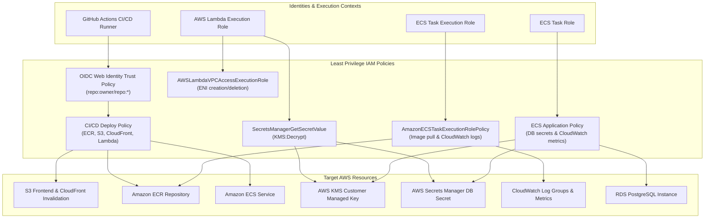

# Access Control with AWS IAM and Security Configurations

## 1. Security Philosophy
The architecture is built on the **Principle of Least Privilege (PoLP)** and **Defense in Depth**:
- Zero public exposure for databases and private compute services.
- Identity-based access controls using AWS IAM roles rather than static access keys.
- Hardware-backed encryption at rest using AWS KMS Customer Managed Keys (CMKs).
- Cryptographic isolation of secrets using AWS Secrets Manager.
- OpenID Connect (OIDC) authentication for GitHub Actions CI/CD to eliminate long-lived AWS credentials.

---

## 2. IAM Roles & Policy Architecture



---

## 3. Detailed IAM Role Definitions

### A. AWS Lambda Execution Role
Lambda functions running inside a VPC require permissions to attach Elastic Network Interfaces (ENIs) to the private subnets, read database credentials from Secrets Manager, and send metrics:

```json
{
  "Version": "2012-10-17",
  "Statement": [
    {
      "Effect": "Allow",
      "Action": [
        "logs:CreateLogGroup",
        "logs:CreateLogStream",
        "logs:PutLogEvents"
      ],
      "Resource": "arn:aws:logs:*:*:log-group:/aws/lambda/*"
    },
    {
      "Effect": "Allow",
      "Action": [
        "ec2:CreateNetworkInterface",
        "ec2:DescribeNetworkInterfaces",
        "ec2:DeleteNetworkInterface",
        "ec2:AssignPrivateIpAddresses",
        "ec2:UnassignPrivateIpAddresses"
      ],
      "Resource": "*"
    },
    {
      "Effect": "Allow",
      "Action": [
        "secretsmanager:GetSecretValue"
      ],
      "Resource": "arn:aws:secretsmanager:us-east-1:*:secret:prod/rds/postgresql/credentials*"
    },
    {
      "Effect": "Allow",
      "Action": [
        "kms:Decrypt"
      ],
      "Resource": "arn:aws:kms:us-east-1:*:key/*"
    },
    {
      "Effect": "Allow",
      "Action": [
        "execute-api:ManageConnections"
      ],
      "Resource": "arn:aws:execute-api:*:*:**/@connections/*"
    }
  ]
}
```

---

### B. ECS Fargate Roles: Execution vs. Task Role

AWS ECS Fargate cleanly separates the container agent runtime permissions from application permissions:

1. **ECS Task Execution Role (`prod-ecs-task-execution-role`)**:
   - Used by the AWS ECS infrastructure daemon.
   - Permissions: Pull image from ECR (`ecr:GetAuthorizationToken`, `ecr:BatchGetImage`), inject Secrets Manager secrets into environment variables (`secretsmanager:GetSecretValue`), write stream logs to CloudWatch.
2. **ECS Task Role (`prod-ecs-task-role`)**:
   - Assumed directly by the Node.js application running inside the container.
   - Permissions: Read secrets dynamically, decrypt KMS keys, emit custom CloudWatch metrics, and connect to RDS PostgreSQL.

---

### C. GitHub Actions OIDC Keyless Role

Instead of storing dangerous, static `AWS_ACCESS_KEY_ID` and `AWS_SECRET_ACCESS_KEY` in GitHub repository secrets, the setup utilizes **AWS IAM OpenID Connect (OIDC)**:

#### Trust Relationship:
```json
{
  "Version": "2012-10-17",
  "Statement": [
    {
      "Effect": "Allow",
      "Principal": {
        "Federated": "arn:aws:iam::123456789012:oidc-provider/token.actions.githubusercontent.com"
      },
      "Action": "sts:AssumeRoleWithWebIdentity",
      "Condition": {
        "StringEquals": {
          "token.actions.githubusercontent.com:aud": "sts.amazonaws.com"
        },
        "StringLike": {
          "token.actions.githubusercontent.com:sub": "repo:my-organization/graphql-serverless-architecture:*"
        }
      }
    }
  ]
}
```

**Benefits**:
- **Zero Credential Leak Risk**: Temporary tokens are minted on-demand with a 1-hour expiration.
- **Strict Scoping**: Limited to specific repositories, branches, or environments.
- **Full CloudTrail Auditability**: Every GitHub Actions deployment is logged with the workflow run ID.

---

## 4. Frontend Security: S3 Origin Access Control (OAC)

The React SPA is deployed to Amazon S3 with **all public access blocked**. Direct S3 website hosting is disabled.

Instead, Amazon CloudFront communicates with S3 via **Origin Access Control (OAC)** with AWS SigV4 request signing.

### S3 Bucket Policy:
```json
{
  "Version": "2012-10-17",
  "Statement": [
    {
      "Sid": "AllowCloudFrontServicePrincipalReadOnly",
      "Effect": "Allow",
      "Principal": {
        "Service": "cloudfront.amazonaws.com"
      },
      "Action": "s3:GetObject",
      "Resource": "arn:aws:s3:::prod-react-frontend-*/*",
      "Condition": {
        "StringEquals": {
          "AWS:SourceArn": "arn:aws:cloudfront::123456789012:distribution/E1234EXAMPLE"
        }
      }
    }
  ]
}
```

### Security Headers Configured via CloudFront Response Policy:
- `Strict-Transport-Security`: `max-age=31536000; includeSubDomains; preload`
- `X-Frame-Options`: `DENY` (prevents clickjacking)
- `X-Content-Type-Options`: `nosniff` (prevents MIME type sniffing)
- `Referrer-Policy`: `strict-origin-when-cross-origin`
- `Content-Security-Policy`: Restricts resource loads to trusted CDNs and APIs.
