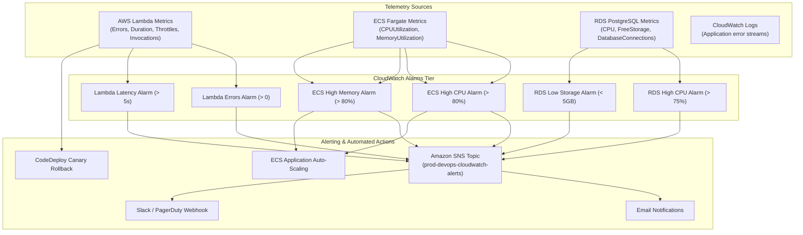

# Monitoring, Scaling, and Rollback Strategy

## 1. Observability Architecture with AWS CloudWatch

The monitoring architecture provides real-time visibility across all layers of the serverless GraphQL system, automatically alerting the operations team when performance thresholds are exceeded.



---

## 2. CloudWatch Alarms Matrix

| Resource | Metric | Evaluation Period | Threshold | Severity | Automated Action |
| :--- | :--- | :--- | :--- | :--- | :--- |
| **Lambda (All)** | `Errors` | 1 minute | `> 0` | High | Alert SNS + Trigger CodeDeploy Canary Rollback |
| **Lambda (All)** | `Duration` | 2 minutes | `> 5000 ms` | Medium | Alert SNS |
| **Lambda (All)** | `Throttles` | 1 minute | `> 0` | High | Alert SNS (Increase concurrency limit) |
| **ECS Fargate** | `CPUUtilization` | 2 minutes | `> 80%` | High | Alert SNS + Scale out tasks |
| **ECS Fargate** | `MemoryUtilization` | 2 minutes | `> 80%` | High | Alert SNS + Scale out tasks |
| **RDS PostgreSQL**| `CPUUtilization` | 2 minutes | `> 75%` | High | Alert SNS (Assess query performance) |
| **RDS PostgreSQL**| `FreeStorageSpace` | 5 minutes | `< 5 GB` | Critical | Alert SNS (Trigger storage auto-scaling) |
| **RDS PostgreSQL**| `DatabaseConnections`| 1 minute | `> 80` | High | Alert SNS |

---

## 3. Scaling Strategy

### A. AWS ECS Fargate Auto-Scaling
Configured in `modules/ecs/main.tf` via `aws_appautoscaling_policy`:
- **Target Tracking Policy (CPU)**: Maintains average CPU utilization at **70%**.
- **Target Tracking Policy (Memory)**: Maintains average memory utilization at **75%**.
- **Capacity Limits**:
  - Minimum Tasks: 2 (ensures multi-AZ redundancy).
  - Maximum Tasks: 10 (protects against unexpected traffic spikes and runaway cost).
- **Cooldown Periods**: Scale-out cooldown: 60 seconds; Scale-in cooldown: 300 seconds (prevents thrashing).

### B. AWS Lambda Concurrency Management
- Default on-demand auto-scaling up to the account concurrency limit.
- Provisioned concurrency configured for the `graphqlHandler` to eliminate cold starts on latency-sensitive endpoints.

### C. RDS PostgreSQL Storage Auto-Scaling
- Dynamic storage expansion from 20 GB to 100 GB without downtime.

---

## 4. Multi-Tier Rollback Strategy

Deployment failures are mitigated through automated, multi-tiered rollback mechanisms:

```
┌────────────────────────────────────────────────────────┐
│               MULTI-TIER ROLLBACK MATRIX               │
├─────────────────┬──────────────────────────────────────┤
│ Tier            │ Rollback Mechanism                   │
├─────────────────┼──────────────────────────────────────┤
│ Frontend SPA    │ S3 Versioning & Automated Snapshot   │
│ Lambda Backend  │ AWS CodeDeploy Canary Rollback       │
│ ECS Fargate     │ ECS Deployment Circuit Breaker       │
│ Infrastructure  │ Terraform Git Revert & State Lock    │
└─────────────────┴──────────────────────────────────────┘
```

### 1. Frontend SPA Rollback (S3 + CloudFront)
- **Mechanism**:
  - `deploy-frontend.yml` creates a timestamped snapshot of the current S3 objects before deploying the new build.
  - An automated smoke test validates the CloudFront distribution endpoint (`HTTP 200`).
  - If the test fails, GitHub Actions immediately runs:
    ```bash
    aws s3 sync $BACKUP_PATH s3://${{ secrets.S3_FRONTEND_BUCKET }}/ --delete
    aws cloudfront create-invalidation --distribution-id ${{ secrets.CLOUDFRONT_DISTRIBUTION_ID }} --paths "/*"
    ```

### 2. Lambda Backend Rollback (Serverless / SAM)
- **Mechanism**:
  - Uses `Canary10Percent5Minutes` deployment preference via AWS CodeDeploy.
  - 10% of production traffic is routed to the new Lambda version.
  - If the CloudWatch alarm (`prod-graphql-handler-errors`) fires during the 5-minute canary window, CodeDeploy cancels the deployment and shifts 100% of traffic back to the previous stable alias.

### 3. ECS Fargate Rollback (Deployment Circuit Breaker)
- **Mechanism**:
  - Configured with `deployment_circuit_breaker { enable = true, rollback = true }`.
  - When a new container image is deployed, ECS monitors container health check responses (`/health`).
  - If new tasks fail health checks or exit repeatedly, the circuit breaker stops the deployment and automatically rolls back to the previous stable Task Definition without human intervention.
